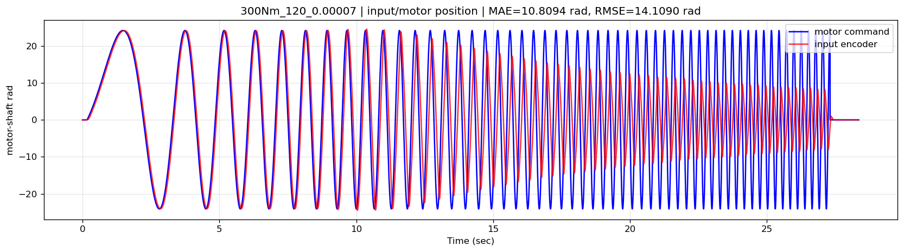
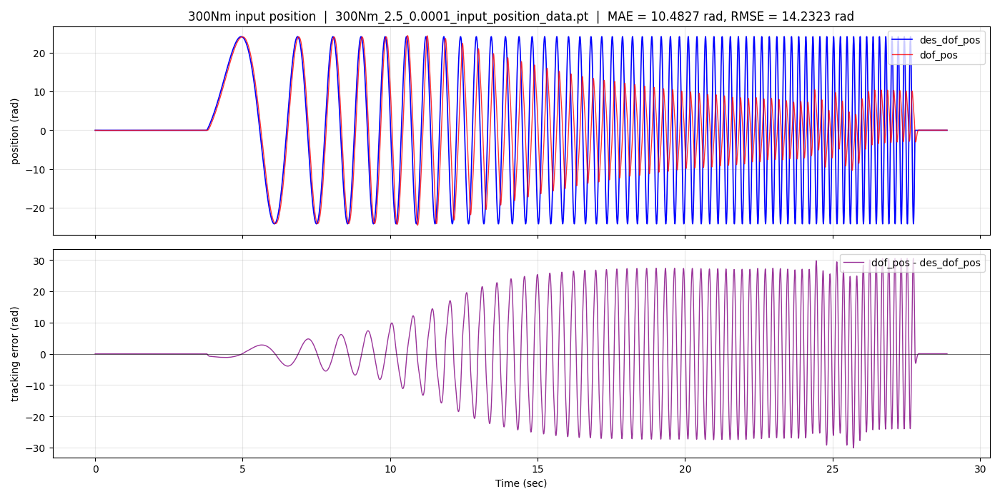
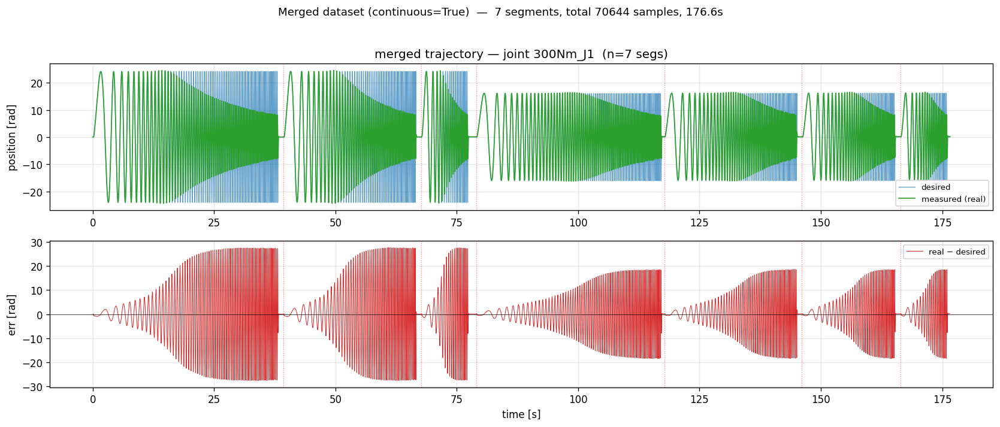
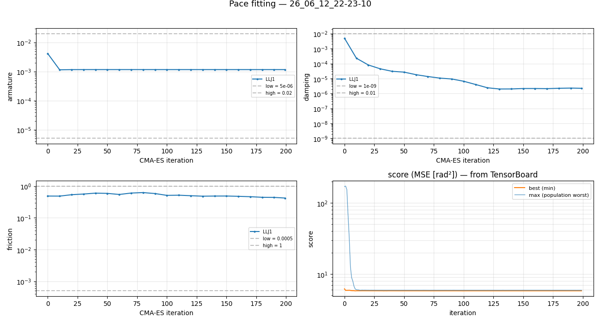
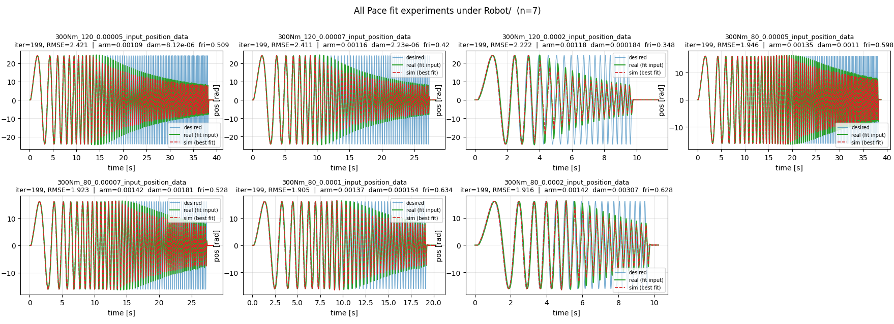
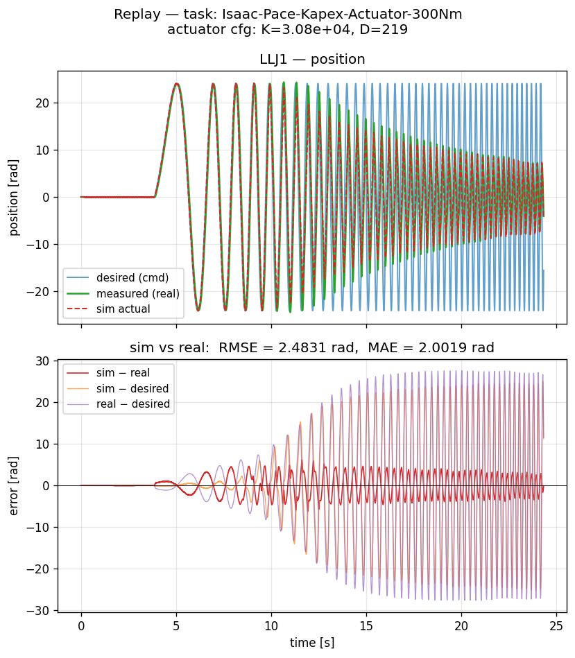
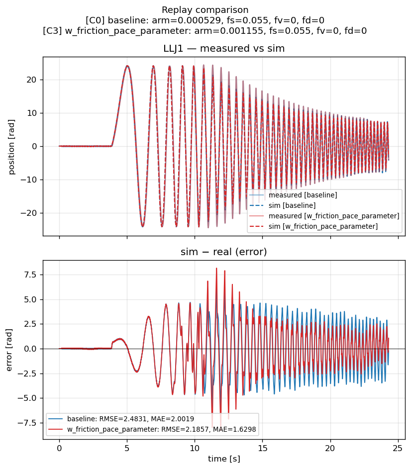

# Rotor 액추에이터 시스템 식별 (sim-to-real)

CMA-ES 기반으로 모터 (rotor) 의 동역학 파라미터 (armature, viscous damping, friction) 를
**실제 측정 데이터** 에 fitting 하여 시뮬레이션과 실제 로봇 간의 격차를 줄이는 실험 환경.


## 폴더 구조

```
pace-humanoid/
├── scripts/                   # 실험 실행 / 데이터 처리 스크립트
│   ├── export_dataSingle.py   # CSV → PT 변환 (입력 데이터 준비)
│   ├── data_check.py          # PT 파일 통계 확인
│   ├── result_plot.py         # 한 fit run 의 상세 plot
│   ├── summarize_all_fits.py  # 모든 fit run 한 figure 에 요약
│   ├── compare_replays.py     # 두 파라미터셋 replay 비교
│   ├── merge_datasets.py      # 여러 데이터셋 stitch (통합 fit 용)
│   └── pace/
│       ├── fit_actuator.py      # CMA-ES 메인 (반복 파라미터 탐색)
│       └── trajectory_plot.py   # 고정 cfg 로 단일 replay (검증용)
│
├── source/pace_sim2real/        # 핵심 Python 모듈 (Isaac Lab task 패키지)
│   └── pace_sim2real/
│       ├── optim/
│       │   └── cma_es_actuator.py    # CMA-ES 옵티마이저 클래스
│       ├── utils/
│       │   ├── pace_actuator.py      # PaceDCMotor actuator 모델
│       │   ├── pace_actuator_cfg.py  # PaceDCMotorCfg dataclass
│       │   ├── assetloader.py        # URDF loader 유틸
│       │   └── paths.py              # project_root() 등 경로 헬퍼
│       └── tasks/manager_based/pace/
│           ├── ACT_CFG.py             # 모터별 ArticulationCfg (RO80/RO100/RI60)
│           ├── act_env_cfg.py     # 액추에이터 fit env (task ID 등록)
│           ├── pace_sim2real_env_cfg.py # 베이스 env cfg
│           └── mdp/rewards.py
│
├── RO100/RO100_motor.urdf       # 300Nm 모터 URDF
├── RO80/RO80_motor.urdf         # 100Nm 모터 URDF
├── RI60/RI60_motor.urdf         # 20Nm 모터 URDF
│
├── data/611/                    # 실험 데이터 (현재 활성)
│   └── logs/                    # ElmoChart CSV / 변환된 PT
│
└── logs/                        # 실험 결과
    ├── pace/                    # fit_actuator 결과 (CMA-ES run 별 timestamp 폴더)
    └── pace_replay/             # trajectory_plot replay 결과
```

---

## 주요 스크립트 가이드

### 1. 데이터 변환 — `scripts/export_dataSingle.py`

 CSV (data/611 패턴) 를 **fit_actuator 가 사용하는 .pt** 포맷으로 변환.

```bash
# 폴더 안의 모든 CSV 각각 변환
python scripts/export_dataSingle.py --input_folder data/611/logs --motor_type 300

# 단일 파일
python scripts/export_dataSingle.py --input_folder data/611/logs/120_0.00007.csv --motor_type 300
```

> 
> 특징:
> - 데이터 수집에 사용된 Hz 와 sim dt 를 맞추기 위한 샘플링 적용
> - 전처리가 완료된 데이터는 png 형식으로 저장

---

### 2. 데이터 확인 — `scripts/data_check.py`

변환된 `.pt` 파일의 통계 (범위, 샘플 수, dt 등) 출력. 입력 데이터 sanity check 용.

```bash
$ python scripts/data_check.py --motor_type 300 --data_type input --file <your_pt_file_path>
```

```bash
$ python scripts/data_check.py --motor_type 300 --data_type input --file data/611/logs/300Nm_2.5_0.0001_input_position_data.pt
[INFO] loaded /home/kist/work/workspace/pace-humanoid/data/611/logs/300Nm_2.5_0.0001_input_position_data.pt
  motor_type  : 300Nm
  data_type   : input
  joint_names : ['300Nm_J1']
  samples     : 11553
  time range  : 0.0000 ~ 28.8800 s  (dt avg ≈ 0.00250 s)
  dof_pos     : range [-24.4570, +24.4052] rad, amp ≈ ±24.4311 rad
  des_dof_pos : range [-24.1272, +24.1272] rad, amp ≈ ±24.1272 rad
  tracking    : MAE = 10.4827 rad,  RMSE = 14.2323 rad
  max error   : 30.5485 rad
```


---

### 3. 여러 데이터 합치기 — `scripts/merge_datasets.py`

여러 trajectory 를 하나의 긴 trajectory 로 stitch. 다양한 주파수/진폭의 trajectory 를
한 번에 fit 해서 wider-band excitation 효과.

```bash
# 기본 — data/611/logs/ 의 7개 파일 stitch
$ python scripts/merge_datasets.py

# 특정 파일 선택
$ python scripts/merge_datasets.py \
    --files data/611/logs/300Nm_80_0.00005_input_position_data.pt \
            data/611/logs/300Nm_80_0.0001_input_position_data.pt
```


**출력**: `300Nm_merged_input_position_data.pt`.



---

### 4. 액추에이터 파라미터 찾기 — `scripts/pace/fit_actuator.py`

CMA-ES 로 반복적으로 파라미터 탐색. **메인 fit 스크립트**.

```bash
python scripts/pace/fit_actuator.py \
    --task Isaac-Pace-Actuator-300Nm \
    --num_envs 512 \
    --headless
```

**탐색 파라미터** (`ACT_CFG.py` 의 `MOTOR_SPECS` 에서 bound 설정):
- [x] `armature` — rotor 관성 (kg·m²)
- [x] `damping` — viscous friction coefficient (Nm·s/rad)
- [x] `friction` — static friction (Nm)
- [ ] `dynamic_friction` — Coulomb friction (Nm)

**출력**: `logs/pace/Robot/<exp_name>/<timestamp>/` 안에:
- `config.pt` — bounds + real 데이터 + 시간 축
- `mean_NNN.pt` — 매 save_interval generation 의 best mean
- `best_trajectory.pt` — best 파라미터의 sim trajectory
- `events.out.tfevents.*` — TensorBoard 로그 (score / 파라미터 분포)

---

### 5. fit 학습 추이 시각화 — `scripts/result_plot.py`

특정 run 하나의 파라미터 추이 + score curve.

```bash
python scripts/result_plot.py \
    --log_dir logs/pace/Robot/300Nm_80_0.00005_input_position_data/26_06_12_17-38-28
```


**출력**: `<log_dir>/fitting_curves.png` — 2×2 그리드 (armature / damping / friction / score).

---

### 6. 전체 실험 한 figure — `scripts/summarize_all_fits.py`

`logs/pace/Robot/` 의 **모든 fit 실험** 을 표 + grid plot 으로 한꺼번에.

```bash
python scripts/summarize_all_fits.py
python scripts/summarize_all_fits.py --pattern "300Nm_80_*"   # 필터
python scripts/summarize_all_fits.py --cols 3 --no_show       # 헤드리스
```


**출력**:
- 콘솔: 실험별 파라미터 + RMSE 표
- `logs/pace/Robot/summary_all_fits.png` — 각 실험의 desired/real/best-sim 비교 grid

---

### 7. 고정 cfg 로 검증 replay — `scripts/pace/trajectory_plot.py`

CMA-ES 없이 **PACE 로 찾은 파라미터** 및 Dynamics 파라미터를 변경해가며 영향도를 확인하기 위해 사용하는 스크립트.

설정한 파라미터를 기반으로 Isaac Sim 을 가동해 Desired 과 Sim 둘의 Trajectory 비교 plot.

```bash
python scripts/pace/trajectory_plot.py \
    --task Isaac-Pace-Actuator-300Nm \
    --headless --no_show
```

- 아래 플랏의 **sim - real** 이 줄어들어야 함.

**출력**: `logs/pace_replay/Robot/<timestamp>/`
- `replay_data.pt` — desired / measured / sim_actual 텐서 + cfg snapshot
- `replay_compare.png` — 3-line 비교 + error subplot

---

### 8. 두 파라미터셋 비교 — `scripts/compare_replays.py`

위 trajectory_plot 으로 만든 두 개의 `replay_data.pt` 를 한 figure 에 겹쳐 비교.

```bash
python scripts/compare_replays.py \
    --pt1 logs/pace_replay/Robot/<run_A>/replay_data.pt \
    --pt2 logs/pace_replay/Robot/<run_B>/replay_data.pt \
    --label1 "handtuned" --label2 "pace-fit"
```


**출력**: `<pt1 의 폴더>/compare_replays.png` — desired / real / sim-A / sim-B 4 라인 + 두 sim 의 error 비교.
